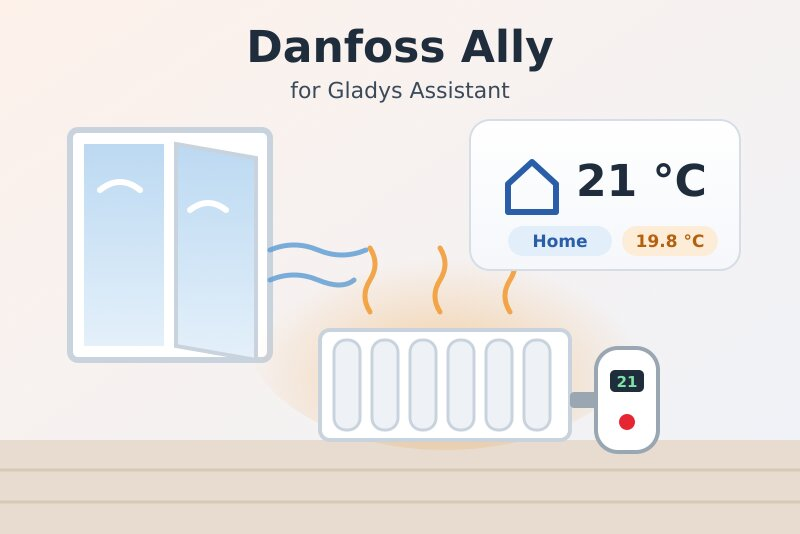
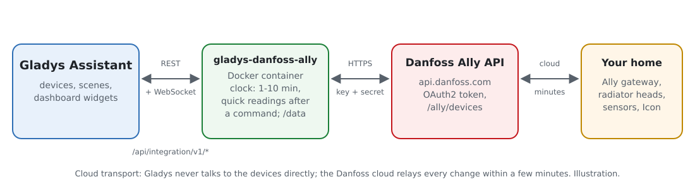
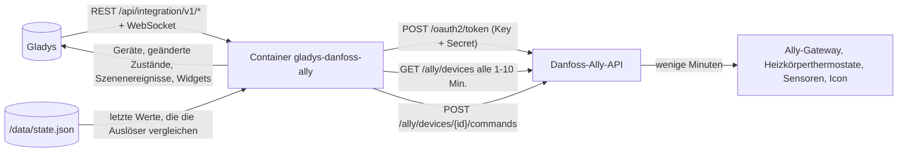
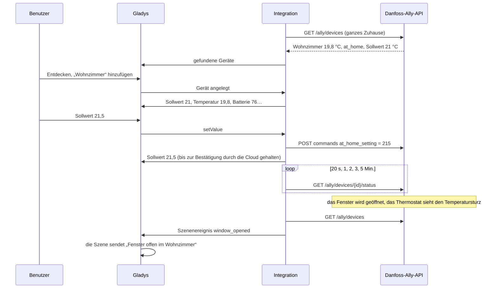
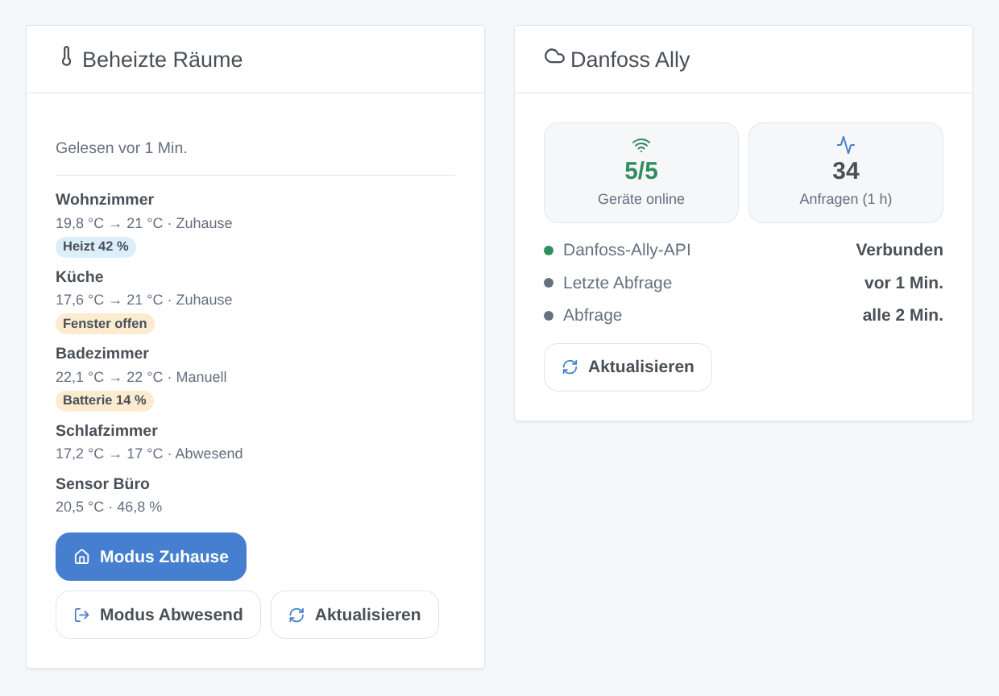

# Gladys Danfoss Ally

[English](README.md) · [Français](README.fr.md) · **Deutsch** · [Español](README.es.md)

[](LICENSE)
[](https://github.com/William-De71/gladys-danfoss-ally/releases)
[](https://github.com/William-De71/gladys-danfoss-ally/actions/workflows/release.yml)
[](https://gladysassistant.com)



Externe Integration von [Gladys Assistant](https://gladysassistant.com) für die **Danfoss-Ally**-Heizung: Heizkörperthermostate, Raumsensoren und Icon-/Icon2-Thermostate der Fußbodenheizung, mit Solltemperatur, Heizmodus, Temperaturen, offenem Fenster, Batterie und Kindersicherung. Sie nutzt die offizielle Danfoss-Ally-API mit Ihrer eigenen Entwickler-App, bietet Szenenauslöser und -aktionen sowie ein Raum-Widget mit den Schaltflächen „Modus Zuhause“ und „Modus Abwesend“ für das ganze Zuhause.

Benutzerdokumentation: [English](docs/en.md) · [Français](docs/fr.md) · [Deutsch](docs/de.md) · [Español](docs/es.md).

Nicht mit Danfoss verbunden. **Noch nicht mit einem echten Danfoss-Konto getestet**: Die Anfragen folgen dem OpenAPI-Dokument der Danfoss-Ally-API und den Statuscodes, die [pydanfossally](https://github.com/MTrab/pydanfossally) an echten Geräten beobachtet hat.

## Funktionen

- **Ein Gerät pro Raum** (Heizkörperthermostat, Raumsensor, Icon-Raumthermostat) mit den Funktionen, die sein Status erlaubt: Solltemperatur (die des aktuellen Modus, 5 bis 35 °C in 0,5-°C-Schritten), Heizmodus und Voreinstellung, Heizzustand, Raum- und Bodentemperatur, Luftfeuchtigkeit, Batterie, offenes Fenster, Kindersicherung.
- Das ganze Zuhause mit **einer einzigen Anfrage** alle 1, 2, 5 oder 10 Minuten gelesen; nach einem Befehl 5 Minuten lang schnelle Abfragen dieses Geräts, der angeforderte Wert bleibt so lange erhalten.
- **7 Szenenauslöser**, **4 Szenenaktionen** und **2 Dashboard-Widgets** (unten), eine Schaltfläche **Verbindung testen**.
- Die Drosselung von Danfoss wird beachtet: höchstens etwa drei Anfragen pro Sekunde, ein 429 verlangsamt die Abfragen, statt zu beharren.
- Vier Sprachen überall: Englisch, Französisch, Deutsch, Spanisch.

## Funktionsweise





Von einer Solltemperatur zu einer Szene:



### Transport

`transports: ["cloud"]`: Jede Anfrage geht mit Ihrem Consumer Key und Secret an `api.danfoss.com`; die Danfoss-Cloud gibt die Änderungen an das Ally-Gateway weiter, was in beide Richtungen **einige Minuten** dauert. Danfoss bietet keine lokale API für das Ally-Gateway. `/data` speichert nur die letzten Werte, die die Szenenauslöser vergleichen, und den Zeitpunkt der zuletzt gesendeten externen Temperatur.

## Geräte und Funktionen

| Funktion         | Kategorie / Typ                     | Einheit                                                             | Schreibbar                        |
| ---------------- | ----------------------------------- | ------------------------------------------------------------------- | --------------------------------- |
| Solltemperatur   | `thermostat` / `target-temperature` | °C, 5–35 in 0,5er-Schritten                                         | ja (Sollwert des aktuellen Modus) |
| Heizmodus        | `thermostat` / `mode`               | aus (Pause), heizen (Manuell), auto (Zeitplan)                      | ja                                |
| Voreinstellung   | `thermostat` / `preset`             | Frostschutz (Pause), abwesend (Abwesend, Urlaub), Komfort (Zuhause) | ja                                |
| Heizt            | `thermostat` / `operating-state`    | inaktiv / heizt                                                     | nein                              |
| Raumtemperatur   | `temperature-sensor` / `decimal`    | °C                                                                  | nein                              |
| Bodentemperatur  | `temperature-sensor` / `decimal`    | °C                                                                  | nein                              |
| Luftfeuchtigkeit | `humidity-sensor` / `decimal`       | %                                                                   | nein                              |
| Batterie         | `battery` / `integer`               | %                                                                   | nein                              |
| Offenes Fenster  | `opening-sensor` / `binary`         | 0 offen, 1 geschlossen                                              | nein                              |
| Kindersicherung  | `child-lock` / `binary`             | an / aus                                                            | ja                                |

Ein Heizkörperthermostat erhält 8 Funktionen, ein Icon2-Thermostat mit Bodenfühler 9, ein Raumsensor 3, ein Icon-Thermostat der ersten Generation nur seine Solltemperatur. Gateway und Kesselrelais melden nichts Anzeigbares: Sie werden nicht angeboten. Die Ventilöffnung in % hat keine Gladys-Kategorie: Sie erscheint im Raum-Widget, und „Heizt“ sagt, ob das Ventil offen ist.

## Szenenauslöser, -aktionen und Widgets



Widgets:

- **Beheizte Räume**: Temperatur, Solltemperatur, Modus und ein Badge pro Raum (offline, Störung, Fenster offen, Batterie schwach, heizt), Details per Tippen, **Modus Zuhause** / **Modus Abwesend** für alle Thermostate auf einmal, **Aktualisieren**. Einstellungen: die anzuzeigenden Räume (höchstens 8).
- **Danfoss Ally**: Verbindung zur API, Geräte online, Anfragen der letzten Stunde, **Aktualisieren**.

Szenenauslöser (jeweils nach Gerät filterbar): ein Fenster wird geöffnet, ein Fenster wird geschlossen, eine Batterie ist schwach (einstellbare Schwelle, einmal bis zum Wechsel), ein Gerät geht offline, ein Gerät ist wieder online, ein Gerät meldet eine Störung (einmal je neuem Code), der Modus ändert sich (in der Ally-App, am Gerät oder durch den Zeitplan, nie durch Gladys selbst; Filter nach Modus).

Szenenaktionen: Heizmodus ändern (ein Thermostat oder alle), Solltemperatur eines Modus einstellen, ohne den Modus zu wechseln, eine Raumtemperatur an ein verdecktes Heizkörperthermostat senden (eine Zahl oder eine Szenenvariable; höchstens alle 5 Minuten; „off“ beendet es), Thermostate jetzt abfragen.

Beispiele:

- Wenn ein Fenster geöffnet wird → „Fenster offen in {{triggerEvent.data.device_name}}“ melden.
- Wenn alle das Haus verlassen → alle Thermostate auf Abwesend schalten; wenn jemand zurückkommt → Zuhause.
- Wenn eine Batterie schwach ist → „Batterie von {{triggerEvent.data.device_name}} wechseln“ auf eine Aufgabenliste setzen.

## Voraussetzungen

- Gladys Assistant **5.3.0** oder neuer (ältere Instanzen können sie nicht installieren).
- Eine in der Danfoss-Ally-App eingerichtete Danfoss-Ally-Anlage mit E-Mail-Konto.
- Ein Konto auf [developer.danfoss.com](https://developer.danfoss.com) mit **derselben E-Mail-Adresse** (Groß-/Kleinschreibung beachten), eine App mit aktivierter **Danfoss Ally API**, deren Consumer Key und Consumer Secret. Kostenlos für den privaten Gebrauch, ohne Support von Danfoss.

## Installation

- **Aus dem Store**: Integrationen → Danfoss Ally → Installieren.
- **Über die Repository-URL**: Integrationen → externe Integration → `https://github.com/William-De71/gladys-danfoss-ally`.
- **Entwicklermodus**: `npm start` mit den von Gladys gelieferten Variablen starten (siehe Entwicklung).

## Konfiguration

| Feld oder Schaltfläche     | Standard    | Bedeutung                                                           |
| -------------------------- | ----------- | ------------------------------------------------------------------- |
| Consumer Key               | —           | Pflicht, der Schlüssel Ihrer App im Entwicklerportal                |
| Consumer Secret            | —           | Pflicht, ein Geheimnis: nie wieder angezeigt, nie protokolliert     |
| Abfrageintervall           | 2 Min.      | 1, 2, 5 oder 10 Minuten; eine Anfrage für das ganze Zuhause         |
| Schwelle schwache Batterie | 20 %        | 5 bis 50, für den Auslöser „Eine Batterie ist schwach“              |
| Sprache der Gerätetexte    | automatisch | Namen der Funktionen und Meldungen der Schaltfläche                 |
| Verbindung testen          | —           | Liest die Geräte jetzt und listet sie mit Modell und Funktionen auf |

## Verwendung

1. Consumer Key und Secret einfügen, dann **Verbindung testen** klicken (Integrationen → Danfoss Ally → Konfiguration).
2. **Entdecken**, dann die gewünschten Räume als Geräte hinzufügen.
3. Das Widget **Beheizte Räume** (und das Gladys-Widget **Thermostat** auf einer Solltemperatur) einem Dashboard hinzufügen.
4. Szenen mit den Gerätefunktionen, den Auslösern und den Aktionen erstellen.

## Entwicklung

```bash
npm install
npm test                       # node --test, nie mit Netzwerk
npm run lint                   # ESLint
npm run format:check           # Prettier
npx github:GladysAssistant/integration-store . --skip-image-check
scripts/build-cover.sh         # cover.jpg aus docs/assets/cover.svg
docs/illustrations/render.sh   # docs/assets/widgets.<lang>.png
```

Lokal liest das SDK `GLADYS_HOST_API_URL`, `GLADYS_INTEGRATION_TOKEN` und `GLADYS_INTEGRATION_SELECTOR` (von Gladys im Entwicklermodus geliefert), und die Integration liest `TZ` (Ortszeit der Moduswechsel). `DEBUG=gladys-integration-sdk` zeigt die SDK-Protokolle.

Die Tests decken den API-Client ab (Token, Erneuerung, Basic-Auth, falsche Zugangsdaten, 401 / 403 / 429 / 500, Abstände, URI-kodierte IDs, beide Befehlsantworten), das Datenmodell (Skalen, Sollwert jedes Modus, einzelnes `temp_set`, Modus- und Außentemperaturbefehle, Störungen), die Geräte (die vom Entdecken-Bildschirm verlangten Felder, Kategorie/Typ-Paare, Zuordnung von Modus und Voreinstellung, Werte des Öffnungssensors), die Auslöser, die Widgets (`validateWidgetContent`), das Manifest, die vier Sprachen, das Release-Skript und die ganze Integration gegen den Fake-Gladys des SDK und eine Fake-API (Befehle und schnelle Abfragen, abgelehnte Zugangsdaten, Drosselung, Neustart). `test/structure.test.js` friert jeden gespeicherten Schlüssel ein.

## Release-Prozess


Jeder Merge auf `main` startet die CI und berechnet dann die Version aus den [Conventional Commits](https://www.conventionalcommits.org/) seit dem letzten Tag: `feat` → Minor, `fix` / `perf` → Patch, `!` oder `BREAKING CHANGE` → Major (ein Minor unter 1.0.0); `docs`, `chore`, `ci`, `test`, `style`, `refactor`, `build` allein veröffentlichen nichts. Der Changelog-Abschnitt wird erzeugt, der Tag gepusht, das Multi-Arch-Image gebaut, dann erhält `main` den Release-Commit, die GitHub Release wird erstellt und ein letzter Job prüft das öffentliche Image, den Store-Validator und das Topic.

- Der Titel des Pull Requests wird zum Squash-Commit und dann zur Changelog-Zeile: auf Englisch, für den Benutzer (`pr-title.yml` prüft ihn). `CHANGELOG.md` nie von Hand bearbeiten.
- 1.0.0 ist eine Entscheidung: Actions → Release → Run workflow mit `release-as: 1.0.0`. `dry-run` zeigt Version und Notizen, ohne zu veröffentlichen.
- **Geschützter Branch**: Die Release pusht ihren Commit mit `GITHUB_TOKEN` auf `main`. Das Ruleset `protect-main` (kein Löschen, kein Force-Push) lässt ihn durch; eine strengere Regel (Pull Request Pflicht, Status-Checks) bräuchte GitHub Actions in der Bypass-Liste oder eine GitHub App.
- Nach der ersten Release das `ghcr.io`-Paket öffentlich machen (Package settings → Change visibility), sonst kann Gladys es nicht laden.

## Fehlerbehebung

Siehe [docs/de.md](docs/de.md#fehlerbehebung). Melden Sie Probleme mit den Versionen von Gladys und der Integration, Ihren Danfoss-Modellen, dem Ergebnis von „Verbindung testen“ und den Protokollen der Integration. Fügen Sie nie Ihr Consumer Secret ein.

## Mitwirken

Issues und Pull Requests sind willkommen. Führen Sie vor einem Pull Request `npm run format:check && npm run lint && npm test` aus und lassen Sie jede externe ID und jeden gespeicherten Schlüssel unverändert (siehe [CLAUDE.md](CLAUDE.md)).

## Sicherheit

Siehe [SECURITY.md](SECURITY.md): Schwachstellen bitte vertraulich melden. Das Consumer Secret ist ein `secret`-Feld: nie protokolliert, nie in `/data` geschrieben, nur per HTTPS an `api.danfoss.com` gesendet, um ein Token zu erhalten; weder Token noch Secret erscheinen in einer Fehlermeldung.

## Screenshots folgen

Die Bilder oben sind Illustrationen, keine Screenshots. Echte Screenshots kommen nach `docs/assets/screenshots/` (PNG, 1280 × 800): `configuration.png` (Zugangsdaten und „Verbindung testen“), `discovery.png`, `device.png` (ein Heizkörperthermostat), `scene.png`.

## Lizenz

[Apache License 2.0](LICENSE) — siehe auch [NOTICE](NOTICE). Danfoss und Danfoss Ally sind Marken der Danfoss A/S. Die Protokollfakten (Statuscodes, Skalen, Befehlssemantik) stammen aus [pydanfossally](https://github.com/MTrab/pydanfossally) von Malene Trab und Mitwirkenden, in NOTICE genannt; es wurde kein Code daraus kopiert, auch nicht aus der Home-Assistant-Komponente. Danke an die Dokumentation und das SDK von Gladys.
