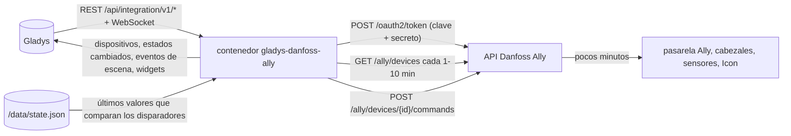
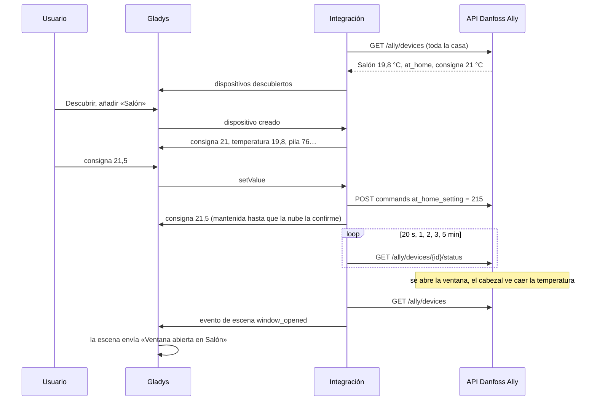
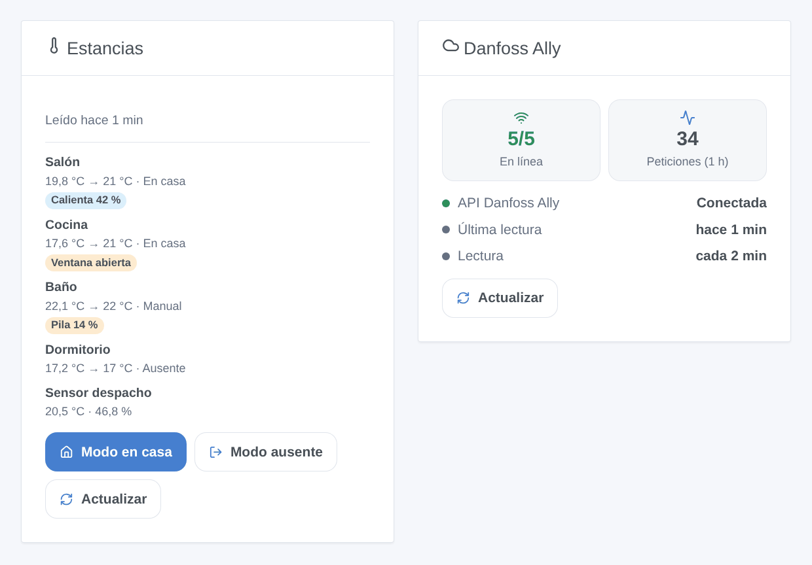

# Gladys Danfoss Ally

[English](README.md) · [Français](README.fr.md) · [Deutsch](README.de.md) · **Español**

[](LICENSE)
[](https://github.com/William-De71/gladys-danfoss-ally/releases)
[](https://github.com/William-De71/gladys-danfoss-ally/actions/workflows/release.yml)
[](https://gladysassistant.com)


Integración externa de [Gladys Assistant](https://gladysassistant.com) para la calefacción **Danfoss Ally**: cabezales termostáticos, sensores de ambiente y termostatos Icon / Icon2 de suelo radiante, con su consigna, su modo de calefacción, sus temperaturas, la ventana abierta, la pila y el bloqueo infantil. Usa la API oficial de Danfoss Ally con su propia aplicación de desarrollador, añade disparadores y acciones de escena, y un widget de estancias con los botones «Modo en casa» y «Modo ausente» para toda la casa.

Documentación de usuario: [English](docs/en.md) · [Français](docs/fr.md) · [Deutsch](docs/de.md) · [Español](docs/es.md).

Sin relación con Danfoss. **Aún no probada con una cuenta Danfoss real**: las peticiones siguen el documento OpenAPI de la API Danfoss Ally y los códigos de estado observados en dispositivos reales por [pydanfossally](https://github.com/MTrab/pydanfossally).

## Funciones

- **Un dispositivo por estancia** (cabezal termostático, sensor de ambiente, termostato Icon), con las funciones que su estado permite: consigna (la del modo actual, de 5 a 35 °C cada 0,5 °C), modo de calefacción y preajuste, estado de calefacción, temperatura ambiente y del suelo, humedad, pila, ventana abierta, bloqueo infantil.
- Toda la casa leída con **una sola petición** cada 1, 2, 5 o 10 minutos; tras una orden, lecturas seguidas de ese dispositivo durante 5 minutos, manteniendo mientras tanto el valor pedido.
- **7 disparadores de escena**, **4 acciones de escena** y **2 widgets del panel** (abajo), un botón **Probar la conexión**.
- Se respeta la limitación de Danfoss: unas tres peticiones por segundo como máximo, un 429 ralentiza las lecturas en lugar de insistir.
- Cuatro idiomas en todas partes: inglés, francés, alemán, español.

## Funcionamiento




De una consigna a una escena:



### Transporte

`transports: ["cloud"]`: cada petición va a `api.danfoss.com` con su Consumer Key y su Secret; la nube de Danfoss transmite los cambios a la pasarela Ally, lo que tarda **unos minutos** en ambos sentidos. Danfoss no ofrece API local para la pasarela Ally. `/data` solo guarda los últimos valores que comparan los disparadores de escena y la hora de la última temperatura externa enviada.

## Dispositivos y funciones

| Función               | Categoría / tipo                    | Unidad                                                              | Modificable                   |
| --------------------- | ----------------------------------- | ------------------------------------------------------------------- | ----------------------------- |
| Consigna              | `thermostat` / `target-temperature` | °C, 5–35 cada 0,5                                                   | sí (consigna del modo actual) |
| Modo de calefacción   | `thermostat` / `mode`               | apagado (Pausa), calefacción (Manual), auto (programa)              | sí                            |
| Preajuste             | `thermostat` / `preset`             | antihielo (Pausa), ausente (Ausente, Vacaciones), confort (En casa) | sí                            |
| Calentando            | `thermostat` / `operating-state`    | inactivo / calentando                                               | no                            |
| Temperatura ambiente  | `temperature-sensor` / `decimal`    | °C                                                                  | no                            |
| Temperatura del suelo | `temperature-sensor` / `decimal`    | °C                                                                  | no                            |
| Humedad               | `humidity-sensor` / `decimal`       | %                                                                   | no                            |
| Pila                  | `battery` / `integer`               | %                                                                   | no                            |
| Ventana abierta       | `opening-sensor` / `binary`         | 0 abierta, 1 cerrada                                                | no                            |
| Bloqueo infantil      | `child-lock` / `binary`             | activado / desactivado                                              | sí                            |

Un cabezal termostático tiene 8 funciones, un termostato Icon2 con sonda de suelo 9, un sensor de ambiente 3, un termostato Icon de primera generación solo su consigna. La pasarela y el relé de caldera no informan nada que mostrar: no se ofrecen. La apertura de válvula en % no tiene categoría en Gladys: aparece en el widget de estancias, y «Calentando» indica si la válvula está abierta.

## Disparadores, acciones de escena y widgets



Widgets:

- **Estancias**: temperatura, consigna, modo y una insignia por estancia (sin conexión, fallo, ventana abierta, pila baja, calentando), detalle al tocar, **Modo en casa** / **Modo ausente** para todos los termostatos a la vez, **Actualizar**. Ajustes: las estancias que mostrar (8 como máximo).
- **Danfoss Ally**: conexión a la API, dispositivos en línea, peticiones de la última hora, **Actualizar**.

Disparadores de escena (cada uno filtrable por dispositivo): se abre una ventana, se cierra una ventana, una pila está baja (umbral ajustable, una vez hasta el cambio), un dispositivo se desconecta, un dispositivo vuelve a conectarse, un dispositivo indica un fallo (una vez por código nuevo), el modo cambia (en la app Ally, en el dispositivo o por su programa, nunca por la propia Gladys; filtro por modo).

Acciones de escena: cambiar el modo de calefacción (un termostato o todos), ajustar la consigna de un modo sin cambiar de modo, enviar una temperatura de estancia a un cabezal tras un cubrerradiador (un número o una variable de escena; como mucho cada 5 minutos; «off» lo detiene), leer los termostatos ahora.

Ejemplos:

- Cuando se abre una ventana → avisar «Ventana abierta en {{triggerEvent.data.device_name}}».
- Cuando todos salen de casa → poner todos los termostatos en Ausente; cuando alguien vuelve → En casa.
- Cuando una pila está baja → añadir «cambiar la pila de {{triggerEvent.data.device_name}}» a una lista de tareas.

## Requisitos

- Gladys Assistant **5.3.0** o posterior (las instancias más antiguas no pueden instalarla).
- Una instalación Danfoss Ally configurada en la app Danfoss Ally con una cuenta de correo.
- Una cuenta en [developer.danfoss.com](https://developer.danfoss.com) con **el mismo correo electrónico** (mayúsculas incluidas), una aplicación con la **Danfoss Ally API** activada, su Consumer Key y su Consumer Secret. Gratuito para uso privado, sin soporte de Danfoss.

## Instalación

- **Desde la tienda**: Integraciones → Danfoss Ally → Instalar.
- **Desde la URL del repositorio**: Integraciones → integración externa → `https://github.com/William-De71/gladys-danfoss-ally`.
- **Modo desarrollador**: ejecute `npm start` con las variables que da Gladys (ver Desarrollo).

## Configuración

| Campo o botón                            | Por defecto | Uso                                                                    |
| ---------------------------------------- | ----------- | ---------------------------------------------------------------------- |
| Consumer Key                             | —           | Obligatorio, la clave de su aplicación en el portal de desarrolladores |
| Consumer Secret                          | —           | Obligatorio, un secreto: nunca se vuelve a mostrar ni se registra      |
| Intervalo de lectura                     | 2 min       | 1, 2, 5 o 10 minutos; una petición para toda la casa                   |
| Umbral de pila baja                      | 20 %        | 5 a 50, para el disparador «Una pila está baja»                        |
| Idioma de los textos de los dispositivos | automático  | Nombres de las funciones y mensajes del botón                          |
| Probar la conexión                       | —           | Lee ahora los dispositivos y los lista con su modelo y sus funciones   |

## Uso

1. Pegue la Consumer Key y el Secret y pulse **Probar la conexión** (Integraciones → Danfoss Ally → Configuración).
2. **Descubrir**, luego añada como dispositivos las estancias que quiera.
3. Añada el widget **Estancias** (y el widget **Termostato** de Gladys sobre una consigna) a un panel.
4. Cree escenas con las funciones de los dispositivos, los disparadores y las acciones.

## Desarrollo

```bash
npm install
npm test                       # node --test, nunca toca la red
npm run lint                   # ESLint
npm run format:check           # Prettier
npx github:GladysAssistant/integration-store . --skip-image-check
scripts/build-cover.sh         # cover.jpg desde docs/assets/cover.svg
docs/illustrations/render.sh   # docs/assets/widgets.<lang>.png
```

En local, el SDK lee `GLADYS_HOST_API_URL`, `GLADYS_INTEGRATION_TOKEN` y `GLADYS_INTEGRATION_SELECTOR` (que da Gladys en modo desarrollador), y la integración lee `TZ` (hora local de los cambios de modo). `DEBUG=gladys-integration-sdk` muestra los registros del SDK.

Las pruebas cubren el cliente de la API (token, renovación, autenticación Basic, credenciales erróneas, 401 / 403 / 429 / 500, espaciado, identificadores codificados, las dos respuestas a las órdenes), el modelo de datos (escalas, consigna de cada modo, `temp_set` único, órdenes de modo y de temperatura externa, fallos), los dispositivos (los campos que exige la pantalla Descubrir, pares categoría / tipo, correspondencia de modo y preajuste, valores del sensor de apertura), los disparadores, los widgets (`validateWidgetContent`), el manifiesto, los cuatro idiomas, el script de publicación y toda la integración frente al Gladys falso del SDK y una API falsa (órdenes y lecturas seguidas, credenciales rechazadas, ralentización, reinicio). `test/structure.test.js` congela cada clave que guardan los usuarios.

## Proceso de publicación


Cada fusión en `main` lanza la CI y calcula la versión a partir de los [Conventional Commits](https://www.conventionalcommits.org/) desde la última etiqueta: `feat` → menor, `fix` / `perf` → parche, `!` o `BREAKING CHANGE` → mayor (una menor por debajo de 1.0.0); `docs`, `chore`, `ci`, `test`, `style`, `refactor`, `build` solos no publican nada. Se genera la sección del changelog, se envía la etiqueta, se construye la imagen multiarquitectura, después `main` recibe el commit de publicación, se crea la GitHub Release y un último job comprueba la imagen pública, el validador de la tienda y el topic.

- El título de la pull request se convierte en el commit squash y luego en la línea del changelog: escríbalo en inglés, para el usuario (`pr-title.yml` lo comprueba). No edite nunca `CHANGELOG.md` a mano.
- La 1.0.0 es una decisión: Actions → Release → Run workflow con `release-as: 1.0.0`. `dry-run` muestra la versión y las notas sin publicar.
- **Rama protegida**: la publicación envía su commit a `main` con `GITHUB_TOKEN`. El ruleset `protect-main` (sin borrado ni force-push) lo deja pasar; una regla más estricta (pull request obligatoria, status checks) necesitaría GitHub Actions en su lista de excepciones, o una GitHub App.
- Tras la primera publicación, haga público el paquete `ghcr.io` (Package settings → Change visibility); si no, Gladys no puede descargarlo.

## Solución de problemas

Vea [docs/es.md](docs/es.md#solución-de-problemas). Informe de los problemas con las versiones de Gladys y de la integración, sus modelos Danfoss, el resultado de «Probar la conexión» y los registros de la integración. No pegue nunca su Consumer Secret.

## Contribuir

Issues y pull requests son bienvenidas. Ejecute `npm run format:check && npm run lint && npm test` antes de abrir una pull request y mantenga sin cambios los identificadores externos y las claves guardadas (vea [CLAUDE.md](CLAUDE.md)).

## Seguridad

Vea [SECURITY.md](SECURITY.md): informe de las vulnerabilidades en privado. El Consumer Secret es un campo `secret`: nunca se registra ni se escribe en `/data`, solo se envía a `api.danfoss.com` por HTTPS para obtener un token; ni el token ni el secreto aparecen en un mensaje de error.

## Capturas pendientes

Las imágenes de arriba son ilustraciones, no capturas de pantalla. Las capturas reales irán a `docs/assets/screenshots/` (PNG, 1280 × 800): `configuration.png` (credenciales y «Probar la conexión»), `discovery.png`, `device.png` (un cabezal termostático), `scene.png`.

## Licencia

[Apache License 2.0](LICENSE) — vea también [NOTICE](NOTICE). Danfoss y Danfoss Ally son marcas de Danfoss A/S. Los datos del protocolo (códigos de estado, escalas, semántica de las órdenes) proceden de [pydanfossally](https://github.com/MTrab/pydanfossally) de Malene Trab y sus colaboradores, citado en NOTICE; no se ha copiado código de él ni del componente de Home Assistant. Gracias a la documentación y al SDK de Gladys.
