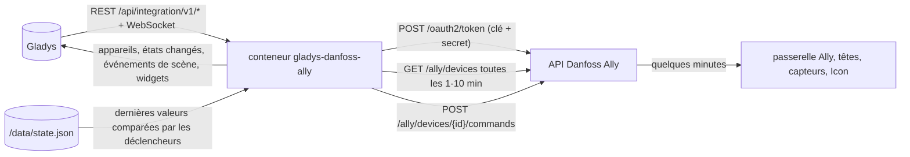
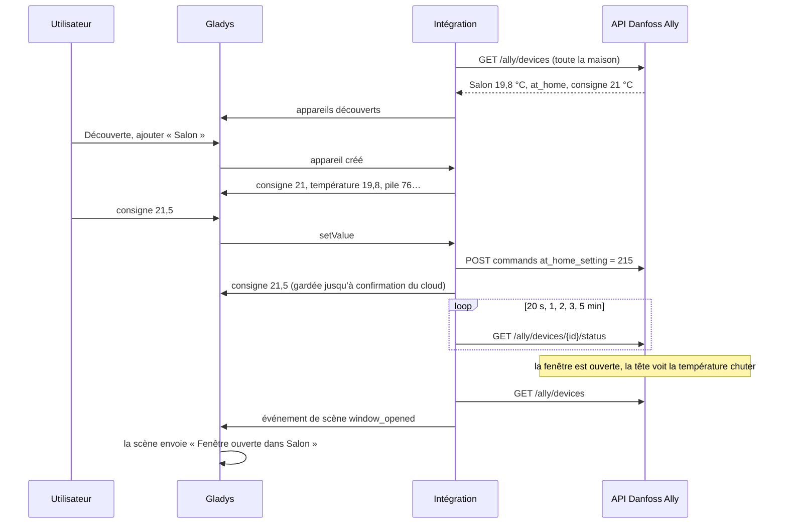
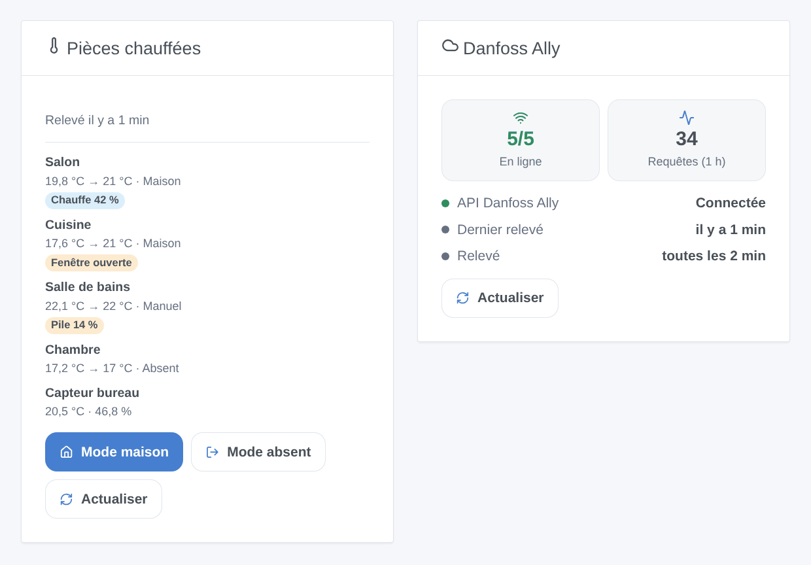

# Gladys Danfoss Ally

[English](README.md) · **Français** · [Deutsch](README.de.md) · [Español](README.es.md)

[](LICENSE)
[](https://github.com/William-De71/gladys-danfoss-ally/releases)
[](https://github.com/William-De71/gladys-danfoss-ally/actions/workflows/release.yml)
[](https://gladysassistant.com)


Intégration externe de [Gladys Assistant](https://gladysassistant.com) pour le chauffage **Danfoss Ally** : têtes thermostatiques, capteurs d’ambiance et thermostats Icon / Icon2 de plancher chauffant, avec leur consigne, leur mode de chauffage, leurs températures, la fenêtre ouverte, la pile et la sécurité enfant. Elle utilise l’API officielle Danfoss Ally avec votre propre application développeur, ajoute des déclencheurs et des actions de scène, et un widget des pièces avec les boutons « Mode maison » et « Mode absent » pour toute la maison.

Documentation utilisateur : [English](docs/en.md) · [Français](docs/fr.md) · [Deutsch](docs/de.md) · [Español](docs/es.md).

Non affiliée à Danfoss. **Pas encore testée avec un vrai compte Danfoss** : les requêtes suivent le document OpenAPI de l’API Danfoss Ally et les codes d’état observés sur de vrais appareils par [pydanfossally](https://github.com/MTrab/pydanfossally).

## Fonctionnalités

- **Un appareil par pièce** (tête thermostatique, capteur d’ambiance, thermostat Icon), avec les fonctionnalités que son état permet : consigne (celle du mode en cours, 5 à 35 °C par 0,5 °C), mode de chauffage et préréglage, chauffe en cours, température ambiante et du sol, humidité, pile, fenêtre ouverte, sécurité enfant.
- Toute la maison relevée en **une seule requête** toutes les 1, 2, 5 ou 10 minutes ; après une commande, des relevés rapprochés de cet appareil pendant 5 minutes, la valeur demandée gardée entre-temps.
- **7 déclencheurs de scène**, **4 actions de scène** et **2 widgets de tableau de bord** (ci-dessous), un bouton **Tester la connexion**.
- La limitation de Danfoss est respectée : environ trois requêtes par seconde au plus, un 429 ralentit les relevés au lieu d’insister.
- Quatre langues partout : anglais, français, allemand, espagnol.

## Fonctionnement




D’une consigne à une scène :



### Transport

`transports: ["cloud"]` : chaque requête part vers `api.danfoss.com` avec votre Consumer Key et votre Secret ; le cloud Danfoss relaie les changements à la passerelle Ally, ce qui prend **quelques minutes** dans les deux sens. Danfoss ne propose pas d’API locale pour la passerelle Ally. `/data` ne garde que les dernières valeurs comparées par les déclencheurs de scène et l’heure de la dernière température externe envoyée.

## Appareils et fonctionnalités

| Fonctionnalité       | Catégorie / type                    | Unité                                                          | Modifiable                      |
| -------------------- | ----------------------------------- | -------------------------------------------------------------- | ------------------------------- |
| Consigne             | `thermostat` / `target-temperature` | °C, 5–35 par 0,5                                               | oui (consigne du mode en cours) |
| Mode de chauffage    | `thermostat` / `mode`               | arrêt (Pause), chauffage (Manuel), auto (programme)            | oui                             |
| Préréglage           | `thermostat` / `preset`             | hors-gel (Pause), absence (Absent, Vacances), confort (Maison) | oui                             |
| Chauffe              | `thermostat` / `operating-state`    | inactif / chauffe                                              | non                             |
| Température ambiante | `temperature-sensor` / `decimal`    | °C                                                             | non                             |
| Température du sol   | `temperature-sensor` / `decimal`    | °C                                                             | non                             |
| Humidité             | `humidity-sensor` / `decimal`       | %                                                              | non                             |
| Pile                 | `battery` / `integer`               | %                                                              | non                             |
| Fenêtre ouverte      | `opening-sensor` / `binary`         | 0 ouverte, 1 fermée                                            | non                             |
| Sécurité enfant      | `child-lock` / `binary`             | activée / désactivée                                           | oui                             |

Une tête thermostatique a 8 fonctionnalités, un thermostat Icon2 avec sonde de sol 9, un capteur d’ambiance 3, un thermostat Icon de première génération sa seule consigne. La passerelle et le relais de chaudière ne remontent rien à afficher : ils ne sont pas proposés. L’ouverture de vanne en % n’a pas de catégorie Gladys : elle s’affiche dans le widget des pièces, et « Chauffe » dit si la vanne est ouverte.

## Déclencheurs, actions de scène et widgets



Widgets :

- **Pièces chauffées** : température, consigne, mode et un badge par pièce (hors ligne, défaut, fenêtre ouverte, pile faible, chauffe), détail au toucher, **Mode maison** / **Mode absent** pour tous les thermostats d’un coup, **Actualiser**. Réglages : les pièces à afficher (8 au plus).
- **Danfoss Ally** : connexion à l’API, appareils en ligne, requêtes de la dernière heure, **Actualiser**.

Déclencheurs de scène (chacun filtrable par appareil) : une fenêtre est ouverte, une fenêtre est fermée, une pile est faible (seuil réglable, une fois jusqu’au remplacement), un appareil passe hors ligne, un appareil est de retour, un appareil signale un défaut (une fois par nouveau code), le mode change (dans l’application Ally, sur l’appareil ou par son programme, jamais par Gladys elle-même ; filtre par mode).

Actions de scène : changer le mode de chauffage (un thermostat ou tous), régler la consigne d’un mode sans changer de mode, envoyer une température de pièce à une tête thermostatique derrière un cache (un nombre ou une variable de scène ; au plus une fois toutes les 5 minutes ; « off » l’arrête), relever les thermostats maintenant.

Exemples :

- Quand une fenêtre est ouverte → notifier « Fenêtre ouverte dans {{triggerEvent.data.device_name}} ».
- Quand tout le monde quitte la maison → passer tous les thermostats en mode Absent ; quand quelqu’un revient → Maison.
- Quand une pile est faible → ajouter « changer la pile de {{triggerEvent.data.device_name}} » à une liste de tâches.

## Prérequis

- Gladys Assistant **5.3.0** ou plus récent (les instances plus anciennes ne peuvent pas l’installer).
- Une installation Danfoss Ally configurée dans l’application Danfoss Ally avec un compte e-mail.
- Un compte sur [developer.danfoss.com](https://developer.danfoss.com) avec **la même adresse e-mail** (majuscules comprises), une application avec l’**API Danfoss Ally** activée, sa Consumer Key et son Consumer Secret. Gratuit pour un usage privé, sans support de Danfoss.

## Installation

- **Depuis le store** : Intégrations → Danfoss Ally → Installer.
- **Depuis l’URL du dépôt** : Intégrations → intégration externe → `https://github.com/William-De71/gladys-danfoss-ally`.
- **Mode développeur** : lancez `npm start` avec les variables données par Gladys (voir Développement).

## Configuration

| Champ ou bouton                 | Défaut      | Rôle                                                                                   |
| ------------------------------- | ----------- | -------------------------------------------------------------------------------------- |
| Consumer Key                    | —           | Obligatoire, la clé de votre application du portail développeur                        |
| Consumer Secret                 | —           | Obligatoire, un secret : jamais réaffiché, jamais écrit dans les journaux              |
| Intervalle de relevé            | 2 min       | 1, 2, 5 ou 10 minutes ; une requête pour toute la maison                               |
| Seuil de pile faible            | 20 %        | 5 à 50, pour le déclencheur « Une pile est faible »                                    |
| Langue des textes des appareils | automatique | Noms des fonctionnalités et messages du bouton                                         |
| Tester la connexion             | —           | Relève les appareils maintenant et les liste avec leur modèle et leurs fonctionnalités |

## Utilisation

1. Collez la Consumer Key et le Secret, puis cliquez sur **Tester la connexion** (Intégrations → Danfoss Ally → Configuration).
2. **Découverte**, puis ajoutez les pièces voulues comme appareils.
3. Ajoutez le widget **Pièces chauffées** (et le widget **Thermostat** de Gladys sur une consigne) à un tableau de bord.
4. Créez des scènes avec les fonctionnalités des appareils, les déclencheurs et les actions.

## Développement

```bash
npm install
npm test                       # node --test, ne touche jamais le réseau
npm run lint                   # ESLint
npm run format:check           # Prettier
npx github:GladysAssistant/integration-store . --skip-image-check
scripts/build-cover.sh         # cover.jpg depuis docs/assets/cover.svg
docs/illustrations/render.sh   # docs/assets/widgets.<lang>.png
```

En local, le SDK lit `GLADYS_HOST_API_URL`, `GLADYS_INTEGRATION_TOKEN` et `GLADYS_INTEGRATION_SELECTOR` (donnés par Gladys en mode développeur), et l’intégration lit `TZ` (heure locale des changements de mode). `DEBUG=gladys-integration-sdk` affiche les journaux du SDK.

Les tests couvrent le client de l’API (jeton, renouvellement, authentification Basic, mauvais identifiants, 401 / 403 / 429 / 500, espacement, identifiants encodés, les deux formes de réponse aux commandes), le modèle de données (échelles, consigne de chaque mode, `temp_set` unique, commandes de mode et de température externe, défauts), les appareils (les champs exigés par l’écran Découverte, couples catégorie / type, correspondance mode et préréglage, valeurs du détecteur d’ouverture), les déclencheurs, les widgets (`validateWidgetContent`), le manifeste, les quatre langues, le script de release, et toute l’intégration face au faux Gladys du SDK et à une fausse API (commandes et relevés rapprochés, identifiants refusés, ralentissement, redémarrage). `test/structure.test.js` fige chaque clé stockée chez les utilisateurs.

## Processus de release


Chaque fusion sur `main` lance la CI, puis calcule la version depuis les [Conventional Commits](https://www.conventionalcommits.org/) depuis le dernier tag : `feat` → mineure, `fix` / `perf` → correctif, `!` ou `BREAKING CHANGE` → majeure (une mineure sous 1.0.0) ; `docs`, `chore`, `ci`, `test`, `style`, `refactor`, `build` seuls ne publient rien. La section du changelog est générée, le tag poussé, l’image multi-architecture construite, puis `main` reçoit le commit de release, la GitHub Release est créée et un dernier job vérifie l’image publique, le validateur du store et le topic.

- Le titre de la pull request devient le commit squash, puis la ligne du changelog : écrivez-le en anglais, pour l’utilisateur (`pr-title.yml` le vérifie). Ne modifiez jamais `CHANGELOG.md` à la main.
- La 1.0.0 est une décision : Actions → Release → Run workflow avec `release-as: 1.0.0`. `dry-run` affiche la version et les notes sans rien publier.
- **Branche protégée** : la release pousse son commit sur `main` avec `GITHUB_TOKEN`. Le ruleset `protect-main` (ni suppression, ni force-push) le laisse passer ; une règle plus stricte (pull request obligatoire, status checks) demanderait d’autoriser GitHub Actions à la contourner, ou une GitHub App.
- Après la première release, rendez le package `ghcr.io` public (Package settings → Change visibility), sinon Gladys ne peut pas le télécharger.

## Dépannage

Voir [docs/fr.md](docs/fr.md#dépannage). Signalez un problème avec les versions de Gladys et de l’intégration, vos modèles Danfoss, le résultat de « Tester la connexion » et les journaux de l’intégration. Ne collez jamais votre Consumer Secret.

## Contribuer

Issues et pull requests sont les bienvenues. Lancez `npm run format:check && npm run lint && npm test` avant d’ouvrir une pull request, et gardez inchangés les identifiants externes et les clés stockées (voir [CLAUDE.md](CLAUDE.md)).

## Sécurité

Voir [SECURITY.md](SECURITY.md) : signalez les failles en privé. Le Consumer Secret est un champ `secret` : jamais écrit dans les journaux ni dans `/data`, envoyé seulement à `api.danfoss.com` en HTTPS pour obtenir un jeton ; ni le jeton ni le secret n’apparaissent dans un message d’erreur.

## Captures à venir

Les images ci-dessus sont des illustrations, pas des captures d’écran. Les vraies captures iront dans `docs/assets/screenshots/` (PNG, 1280 × 800) : `configuration.png` (identifiants et « Tester la connexion »), `discovery.png`, `device.png` (une tête thermostatique), `scene.png`.

## Licence

[Apache License 2.0](LICENSE) — voir aussi [NOTICE](NOTICE). Danfoss et Danfoss Ally sont des marques de Danfoss A/S. Les faits du protocole (codes d’état, échelles, sémantique des commandes) viennent de [pydanfossally](https://github.com/MTrab/pydanfossally) de Malene Trab et ses contributeurs, crédité dans NOTICE ; aucun code n’en a été copié, ni du composant Home Assistant. Merci à la documentation et au SDK de Gladys.
