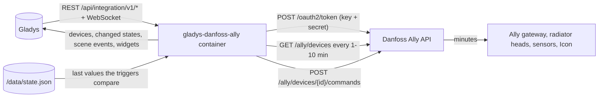
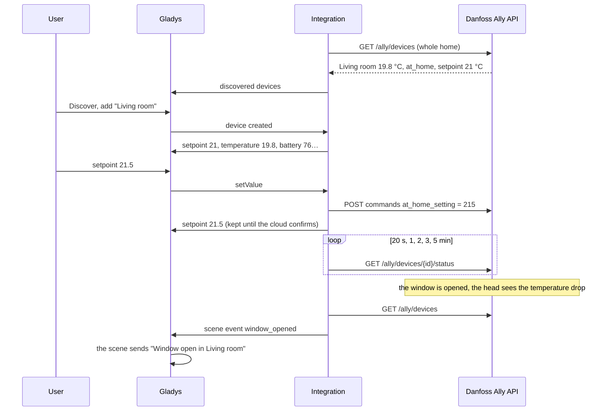
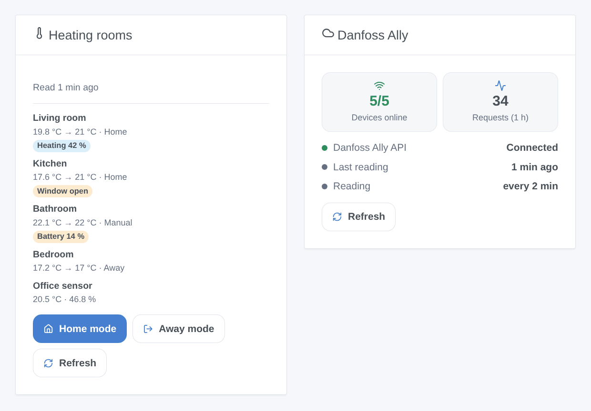

# Gladys Danfoss Ally

**English** · [Français](README.fr.md) · [Deutsch](README.de.md) · [Español](README.es.md)

[](LICENSE)
[](https://github.com/William-De71/gladys-danfoss-ally/releases)
[](https://github.com/William-De71/gladys-danfoss-ally/actions/workflows/release.yml)
[](https://gladysassistant.com)


[Gladys Assistant](https://gladysassistant.com) external integration for **Danfoss Ally** heating: radiator thermostats, room sensors and Icon / Icon2 floor heating thermostats, with their setpoint, heating mode, temperatures, open window, battery and child lock. It uses the official Danfoss Ally API with your own developer app, adds scene triggers and actions, and a rooms widget with "Home mode" and "Away mode" buttons for the whole home.

User documentation: [English](docs/en.md) · [Français](docs/fr.md) · [Deutsch](docs/de.md) · [Español](docs/es.md).

Not affiliated with Danfoss. **Not tested with a real Danfoss account yet**: the requests follow the OpenAPI document of the Danfoss Ally API and the status codes observed on real devices by [pydanfossally](https://github.com/MTrab/pydanfossally).

## Features

- **One device per room** (radiator thermostat, room sensor, Icon room thermostat), with the features its status allows: setpoint (the one of the current mode, 5 to 35 °C by 0.5 °C), heating mode and preset, heating state, room and floor temperature, humidity, battery, open window, child lock.
- The whole home read in **one request** every 1, 2, 5 or 10 minutes; after a command, quick readings of that device for 5 minutes, the value asked for kept meanwhile.
- **7 scene triggers**, **4 scene actions** and **2 dashboard widgets** (below), a **Test the connection** button.
- Danfoss throttling handled: about three requests per second at most, a 429 slows the readings down instead of insisting.
- Four languages everywhere: English, French, German, Spanish.

## How it works




From a setpoint to a scene:



### Transport

`transports: ["cloud"]`: every request goes to `api.danfoss.com` with your Consumer Key and Secret; the Danfoss cloud relays the changes to the Ally gateway, which takes **a few minutes** both ways. Danfoss offers no local API for the Ally gateway. `/data` only keeps the last values the scene triggers compare and the time of the last external temperature sent.

## Devices and features

| Feature           | Category / type                     | Unit                                                | Writable                           |
| ----------------- | ----------------------------------- | --------------------------------------------------- | ---------------------------------- |
| Setpoint          | `thermostat` / `target-temperature` | °C, 5–35 by 0.5                                     | yes (setpoint of the current mode) |
| Heating mode      | `thermostat` / `mode`               | off (Pause), heating (Manual), auto (schedule)      | yes                                |
| Preset            | `thermostat` / `preset`             | frost (Pause), away (Away, Holiday), comfort (Home) | yes                                |
| Heating           | `thermostat` / `operating-state`    | idle / heating                                      | no                                 |
| Room temperature  | `temperature-sensor` / `decimal`    | °C                                                  | no                                 |
| Floor temperature | `temperature-sensor` / `decimal`    | °C                                                  | no                                 |
| Humidity          | `humidity-sensor` / `decimal`       | %                                                   | no                                 |
| Battery           | `battery` / `integer`               | %                                                   | no                                 |
| Open window       | `opening-sensor` / `binary`         | 0 open, 1 closed                                    | no                                 |
| Child lock        | `child-lock` / `binary`             | on / off                                            | yes                                |

A radiator thermostat gets 8 features, an Icon2 thermostat with a floor sensor 9, a room sensor 3, a first-generation Icon thermostat its setpoint only. The gateway and the boiler relay report nothing to show: they are not offered. The valve opening in % has no Gladys category: it shows in the rooms widget, and "Heating" says whether the valve is open.

## Scene triggers, actions and widgets



Widgets:

- **Heating rooms**: temperature, setpoint, mode and a badge per room (offline, fault, window open, low battery, heating), details on tap, **Home mode** / **Away mode** for every thermostat at once, **Refresh**. Settings: the rooms to show (8 at most).
- **Danfoss Ally**: connection to the API, devices online, requests of the last hour, **Refresh**.

Scene triggers (each one filtered by device): a window is opened, a window is closed, a battery is low (configurable threshold, once until replaced), a device goes offline, a device is back online, a device reports a fault (once per new code), the mode changes (in the Ally app, on the device or by its schedule, never by Gladys itself; filter by mode).

Scene actions: change the heating mode (one thermostat or all of them), set the setpoint of a mode without changing the mode, send a room temperature to a radiator thermostat behind a cover (a number or a scene variable; once every 5 minutes at most; "off" stops it), read the thermostats now.

Examples:

- When a window is opened → notify "Window open in {{triggerEvent.data.device_name}}".
- When everyone leaves the house → change the heating mode of every thermostat to Away; when someone comes back → Home.
- When a battery is low → add "replace the battery of {{triggerEvent.data.device_name}}" to a to-do list.

## Requirements

- Gladys Assistant **5.3.0** or later (older instances cannot install it).
- A Danfoss Ally system set up in the Danfoss Ally app with an e-mail account.
- An account on [developer.danfoss.com](https://developer.danfoss.com) with **the same e-mail address** (case matters), an app with the **Danfoss Ally API** enabled, its Consumer Key and Consumer Secret. Free for private use, without support from Danfoss.

## Installation

- **From the store**: Integrations → Danfoss Ally → Install.
- **From the repository URL**: Integrations → external integration → `https://github.com/William-De71/gladys-danfoss-ally`.
- **Developer mode**: run `npm start` with the variables given by Gladys (see Development).

## Configuration

| Field or button              | Default   | Meaning                                                            |
| ---------------------------- | --------- | ------------------------------------------------------------------ |
| Consumer Key                 | —         | Required, the key of your app on the developer portal              |
| Consumer Secret              | —         | Required, a secret: never shown again, never logged                |
| Reading interval             | 2 min     | 1, 2, 5 or 10 minutes; one request for the whole home              |
| Low battery threshold        | 20 %      | 5 to 50, for the "A battery is low" trigger                        |
| Language of the device texts | automatic | Feature names and button messages                                  |
| Test the connection          | —         | Reads the devices now and lists them with their model and features |

## Usage

1. Paste the Consumer Key and Secret, then press **Test the connection** (Integrations → Danfoss Ally → Configuration).
2. **Discover**, then add the rooms you want as devices.
3. Add the **Heating rooms** widget (and the Gladys **Thermostat** widget on a setpoint) to a dashboard.
4. Build scenes with the device features, the triggers and the actions.

## Development

```bash
npm install
npm test                       # node --test, never touches the network
npm run lint                   # ESLint
npm run format:check           # Prettier
npx github:GladysAssistant/integration-store . --skip-image-check
scripts/build-cover.sh         # cover.jpg from docs/assets/cover.svg
docs/illustrations/render.sh   # docs/assets/widgets.<lang>.png
```

Locally, the SDK reads `GLADYS_HOST_API_URL`, `GLADYS_INTEGRATION_TOKEN` and `GLADYS_INTEGRATION_SELECTOR` (given by Gladys in developer mode), and the integration reads `TZ` (local time of the mode changes). `DEBUG=gladys-integration-sdk` shows the SDK logs.

The tests cover the API client (token, renewal, Basic auth, wrong credentials, 401 / 403 / 429 / 500, spacing, URI-encoded ids, both command answers), the data model (scales, setpoint of each mode, single `temp_set`, mode and external temperature commands, faults), the devices (the fields the Discovery screen requires, category / type pairs, mode and preset mapping, opening sensor values), the scene triggers, the widgets (`validateWidgetContent`), the manifest, the four languages, the release script, and the whole integration against the fake Gladys of the SDK and a fake API (commands and quick readings, refused credentials, slow-down, restart). `test/structure.test.js` freezes every key users store.

## Release process


Every merge on `main` runs the CI, then computes the version from the [Conventional Commits](https://www.conventionalcommits.org/) since the last tag: `feat` → minor, `fix` / `perf` → patch, `!` or `BREAKING CHANGE` → major (a minor below 1.0.0); `docs`, `chore`, `ci`, `test`, `style`, `refactor`, `build` alone publish nothing. The changelog section is generated, the tag pushed, the multi-architecture image built, then `main` receives the release commit, the GitHub Release is created and a last job checks the public image, the store validator and the topic.

- The pull request title becomes the squash commit, then the changelog line: write it in English, for the user (`pr-title.yml` checks it). Never edit `CHANGELOG.md` by hand.
- 1.0.0 is a decision: Actions → Release → Run workflow with `release-as: 1.0.0`. `dry-run` shows the version and the notes without publishing.
- **Protected branch**: the release pushes its commit to `main` with `GITHUB_TOKEN`. The `protect-main` ruleset (no deletion, no force-push) lets it through; a stricter rule (pull request required, status checks) would need GitHub Actions in its bypass list, or a GitHub App.
- After the first release, make the `ghcr.io` package public (Package settings → Change visibility), or Gladys cannot pull it.

## Troubleshooting

See [docs/en.md](docs/en.md#troubleshooting). Report issues with the versions of Gladys and of the integration, your Danfoss models, the result of "Test the connection" and the logs of the integration. Never paste your Consumer Secret.

## Contributing

Issues and pull requests are welcome. Run `npm run format:check && npm run lint && npm test` before opening a pull request, and keep every external id and stored key unchanged (see [CLAUDE.md](CLAUDE.md)).

## Security

See [SECURITY.md](SECURITY.md): report vulnerabilities privately. The Consumer Secret is a `secret` field: never logged, never written to `/data`, sent only to `api.danfoss.com` over HTTPS to get a token; neither the token nor the secret appears in an error message.

## Screenshots to come

The images above are illustrations, not screenshots. Real screenshots will go in `docs/assets/screenshots/` (PNG, 1280 × 800): `configuration.png` (credentials and "Test the connection"), `discovery.png`, `device.png` (a radiator thermostat), `scene.png`.

## License

[Apache License 2.0](LICENSE) — see also [NOTICE](NOTICE). Danfoss and Danfoss Ally are trademarks of Danfoss A/S. The protocol facts (status codes, scales, command semantics) come from [pydanfossally](https://github.com/MTrab/pydanfossally) by Malene Trab and contributors, credited in NOTICE; no code was copied from it nor from the Home Assistant component. Thanks to the Gladys documentation and SDK.
